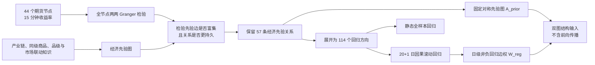

# 经济先验图、Granger 验证与动态回归边权

本项目的目标不是从价格序列中无约束地搜索一张图，而是把**经济结构先验**与**历史统计证据**分开建模：经济先验决定哪些节点之间允许传递消息，滚动回归决定这些既有关系在当前时点的方向、符号、强弱与可信度。最终得到的动态图只是完整预测模型中的一个零件，当前没有加入消息聚合、多层堆叠、预测头和训练流程。

整体流程如下：



## 1. 为什么先建经济图，再做统计验证

期货价格的相关和预测关系不等于真实经济关系。两个没有产业联系的品种也可能因为宏观风险、流动性、交易时段或共同趋势而暂时呈现 Granger 显著。相反，一条真实产业链关系也可能因为传导缓慢、套期保值、库存缓冲、样本窗口过短或当前市场状态而暂时不显著。

因此，本项目不让一次统计检验同时承担“关系是否存在”和“当前关系有多强”两个任务：

- **图的支持集**由经济先验给出，表示允许消息传递的关系范围。
- **Granger 与回归结果**用于验证先验、估计方向，并形成时变边特征。
- **p 值不是删边开关**。短窗口未显著只表示当前数据没有提供足够的增量预测证据，不等于产业关系消失。

权威经济边来自 [data/graph_data/futures_graph_smm_simplified.html](data/graph_data/futures_graph_smm_simplified.html)。当前图包含 57 条逻辑边，关系类型包括：

| `relation_type` | 经济含义 |
| --- | --- |
| `direct_input` | 上游直接作为下游投入，或经直接加工得到下游 |
| `indirect_chain` | 产业路径成立，但中间节点数据尚不完整 |
| `peer_product` | 替代、联合产出或同源产品关系 |
| `grade_or_origin` | 同类原料、品级或交割范围重叠 |
| `market_linkage` | 宏观、板块、价差或用途路径形成的市场联动 |
| `smm_mediated` | 原期货关系经可用 SMM 实体节点收缩后的连接 |

详细经济语义与来源见 [data/graph_data/economic_graph_edge_change_review.md](data/graph_data/economic_graph_edge_change_review.md)。

## 2. 全节点两两 Granger 验证

在限定回归范围之前，先对 44 个期货节点进行无约束的两两 Granger 检验。这个步骤不使用经济图筛选，因此可以作为经济先验的独立统计对照。

### 2.1 数据和配对

每个节点使用 15 分钟收益率 `return_15m`。任意两个品种按 `datetime` 内连接，只保留双方都有有效收益的时点，不填充缺失收益。44 个节点形成

$$
\binom{44}{2}=946
$$

个无序配对，每对检验两个方向，因此共有

$$
44\times 43=1{,}892
$$

个有向结果。

### 2.2 BIC 选择共享滞后阶数

对每个期货对建立二元 VAR，并在

$$
p\in\{0,1,\ldots,40\}
$$

中选择共享滞后阶数。所有候选阶数使用同一个有效样本区间，避免低阶模型仅因拥有更多观测而获得不公平优势。系统 BIC 为

$$
\operatorname{BIC}(p)
=\log\left|\widehat{\Sigma}_p\right|
+\frac{\log n}{n}(2+4p),
$$

其中：

- $p$ 是 VAR 滞后阶数；
- $n$ 是共同有效观测数；
- $\widehat{\Sigma}_p$ 是二元 VAR 残差协方差矩阵；
- $2+4p$ 是二元系统的参数数目。

BIC 选择 $p=0$ 时，只保留截距，不人为提升到一阶，也不生成虚假的 Granger p 值。

### 2.3 方向性 Granger 检验

对于候选方向 $x\rightarrow y$，目标方程为

$$
y_t=\alpha+
\sum_{\ell=1}^{p}a_{\ell}y_{t-\ell}
+\sum_{\ell=1}^{p}\beta_{\ell}x_{t-\ell}
+\varepsilon_t.
$$

Granger 检验的原假设是另一品种的全部滞后系数联合为零：

$$
H_0:\ \beta_1=\beta_2=\cdots=\beta_p=0.
$$

拒绝 $H_0$ 表示：在已经包含 $y$ 自身历史以后，$x$ 的历史仍对 $y$ 提供样本内增量预测信息。它是**预测意义上的 Granger 关系**，不是结构性经济因果。

### 2.4 全节点结果

- 946 个无序配对中，734 对由 BIC 选择 0 阶，占 77.6%。
- 其余 212 对形成 424 个可检验方向。
- 其中原始 $p<0.1$ 的方向为 266 个。
- Benjamini-Hochberg 校正后，$q<0.1$ 的方向仍有 240 个。

这说明全连接候选空间非常稀疏：绝大多数节点对没有足够证据加入联合滞后项。完整结果见 [linear_regression_test/results/no_smm_pairwise_granger/EXPERIMENT_REPORT.md](linear_regression_test/results/no_smm_pairwise_granger/EXPERIMENT_REPORT.md)。

## 3. Granger 结果如何支持经济先验

### 3.1 静态显著关系的富集

在建立当前 SMM 收缩图之前，47 条有效期货经济先验关系已与全节点 Granger 结果做过独立对照。对有向经济边使用经济箭头方向，对无向关系使用两个统计方向中较强的一侧：

- 47 条先验关系中，25 条达到原始 $p<0.1$，比例为 53.2%。
- 在全体 946 个无序期货对中，266 个显著方向对应约 182 个至少一侧显著的无序对，比例约为 19.2%。
- 先验关系的显著命中率约为总体候选对的

$$
\frac{25/47}{182/946}\approx 2.77
$$

倍。

这个对照说明经济知识挑出的关系不是从全部节点对中随机抽取的：它们显著富集于具有增量预测关系的区域。

### 3.2 动态关系的时间持续性

两年动态全节点 Granger 排名中，星数前 100 个方向有 29 个属于经济图，而经济图方向在全部 1,892 个方向中只占约 6%。更重要的是，经济图内关系的加权平均活跃月份和显著跨度明显更长：

| 星数前 100 方向 | 数量 | 加权平均活跃月份 | 加权平均显著跨度 |
| --- | ---: | ---: | ---: |
| 经济图内 | 29 | 6.11 个月 | 317.22 个交易日 |
| 经济图外 | 71 | 1.77 个月 | 76.63 个交易日 |

经济图内关系的显著性更分散于较长时间，而图外高排名关系更容易集中在少数短窗口。这为“经济先验能够筛出更持久、更可解释的关系”提供了直接的经验支持。

这里应使用准确表述：上述结果是经济先验有效性的**直接统计支持和富集证据**，但不是结构因果的数学证明。二元 Granger 仍可能受到共同因子、交易时段和遗漏变量影响。

## 4. 为什么不对所有节点继续做边回归

全节点 Granger 的作用是验证和探索，不是直接生成最终 GNN 的完全图。后续只对经济先验边做精细回归，原因如下。

1. **降低伪关系进入图的概率。** 全节点搜索包含 1,892 个方向，大量短期共同波动会产生统计边；经济先验把候选空间限制在具有明确产业或市场机制的关系上。
2. **控制多重比较和选择偏差。** 如果先在全部方向中按 p 值选边，再用同一批数据估计边权，会把选择噪声带进模型。先验图在回归前固定，避免根据最终表现事后挑边。
3. **避免完全图的信息污染。** GNN 会沿每条边传递消息。把所有节点两两相连会让无关品种的噪声反复混入节点表示，并削弱图结构本身提供的归纳偏置。
4. **保留可解释性。** 先验边可以回溯到直接投入、产业链、替代品或市场联动；全连接图中的每条统计边很难给出稳定经济解释。
5. **让回归承担合适的任务。** 回归负责回答“这条已知关系当前如何表现”，而不是单独决定“经济关系是否存在”。

因此，实验采用两阶段设计：先在全部节点上进行 Granger 对照，验证经济先验关系具有显著性和持续性富集；再把回归资源集中到先验支持集上，估计可供 GNN 使用的有符号动态边特征。这既利用了数据，也避免让噪声替代经济结构。

## 5. 经济先验边的静态与动态回归

当前权威图包含 57 条逻辑边。为估计价格传导的两个统计方向，每条逻辑边展开为

$$
u\rightarrow v,\qquad v\rightarrow u,
$$

共 114 个有向回归方向。这里的方向统一表示

`explanatory_futures` $\rightarrow$ `dependent_futures`。

全节点动态边使用 [linear_regression_test/run_all_node_edge_regressions.py](linear_regression_test/run_all_node_edge_regressions.py) 生成。它从同一 44 节点权威清单构造

$$
\binom{44}{2}=946
$$

个无序期货对，并展开为 1,892 个有向回归方向。该入口直接复用先验边回归的对齐、BIC 选阶、OLS、联合 Wald 检验、20+1 日因果窗口、样本外预测、断点续跑和输出字段，不单独维护另一套统计实现。可先运行小规模检查：

```powershell
.venv/Scripts/python.exe linear_regression_test/run_all_node_edge_regressions.py --mode dynamic --symbols A,AG,AL --last-forecast-days 1 --output-dir linear_regression_test/results/all_node_edge_regressions_smoke --no-resume
```

全量两年动态实验移除 `--symbols` 和 `--last-forecast-days` 即可。全节点结果本身也包含原有 114 个先验方向，但新设计不再把这些方向与先验合并到同一条边上：经济先验关系由固定对称图 $A^{\mathrm{prior}}$ 表达，全节点回归结果由每个预测日的 $W^{\mathrm{reg}}$ 表达，两者是彼此独立的结构输入。

双向估计不表示产业链在经济意义上必然双向，而是让模型分别观察上游到下游和下游到上游的价格发现、预期反馈及共同信息反应。`relation_type` 和原始 `graph_source/graph_target` 仍被保留，以便后续区分经济方向。

### 5.1 静态回归

静态实验使用每对期货的全部共同有效历史，主要用于检查长期样本中是否存在稳定的跨品种滞后关系。114 个方向中：

- 60 个方向由 BIC 选择非零阶；
- 47 个方向的联合 Wald 检验原始 $p<0.05$；
- 49 个方向原始 $p<0.1$。

静态结果证明先验图内部确实包含一批长期统计关联，但静态系数使用了完整历史，不能回填为早期日期的动态边权。

### 5.2 20+1 日动态回归

对每个预测日 $D$：

1. 只使用严格早于 $D$ 的最近 20 个共同交易日；
2. 在训练窗口内从 0 至 40 阶选择 BIC 最优阶数；
3. 拟合参数后在整个第 21 日冻结；
4. 逐 15 分钟格做一步预测，日内只能使用已经发生的历史收益；
5. 保存训练统计、逐滞后系数、联合 Wald 检验和样本外预测指标。

两年实验覆盖 484 个预测交易日：

$$
484\times114=55{,}176
$$

个基线方向-日期窗口，无重复主键。训练期严格早于预测日的检查已通过。

动态结果中，95.96% 的窗口选择 0 阶，只有 2,228 个窗口包含可检验的跨期货滞后项；原始 $p<0.1$ 的窗口为 811 个，占全部窗口 1.47%，占可检验窗口 36.40%。这说明短期传导是稀疏且时变的，也正是采用“固定先验图 + 动态回归图”而不是按日删边的原因。

## 6. 回归图边权如何构建

对方向 $i\rightarrow j$ 和预测日期 $t$，令 $L_{ij,t}$ 为该 20 日训练窗口由 BIC 选择的滞后阶数，$\beta_{ij,\ell,t}$ 为来源期货 $i$ 的第 $\ell$ 阶滞后在目标期货 $j$ 方程中的系数。第一版回归图只表达“是否应当建立有向连接”，不解释净正负作用，因此原始强度定义为非负量。

### 6.1 聚合多阶滞后系数

将同一方向跨期货系数的绝对值相加：

$$
b_{ij,t}=\sum_{\ell=1}^{L_{ij,t}}\left|\beta_{ij,\ell,t}\right|.
$$

绝对值加和避免正负滞后相互抵消：例如 $\beta_1=0.8$、$\beta_2=-0.8$ 时净和为 0，但绝对值和为 1.6，仍应保留连接。代价是权重不再区分促进与抑制，且阶数更多的方向天然可能得到更大的绝对值和；方向性仍由 $i\to j$ 与 $j\to i$ 的独立方程保留。

### 6.2 按日期进行稳健缩放

不同日期和方向的原始系数尺度可能差异很大。**只在当天有效非零方向上**计算绝对系数和的第 75 百分位数。记

$$
\mathcal E_t^{+}=\{(u,v):\text{状态为 fitted},\ L_{uv,t}>0,\ p^{\mathrm{Wald}}_{uv,t}\in[0,1],\ b_{uv,t}>0\},
$$

则

$$
s_t=Q_{0.75}\bigl(\{b_{uv,t}:(u,v)\in\mathcal E_t^{+}\}\bigr).
$$

然后先截断、再除以截断上界，使强度统一落入 $[0,1]$：

$$
r_{ij,t}=\frac{1}{2}\operatorname{clip}\left(
\frac{b_{ij,t}}{s_t+\epsilon},
0,z_{\max}
\right).
$$

当前默认 $\epsilon=10^{-8}$、$z_{\max}=2$。其中：

- 第 75 百分位数比均值和标准差更不容易被少数极端回归系数拉动；
- **只在非零有效方向上取分位数**：每天 1,892 个方向中绝大多数为零阶，若在全部方向上取分位数，实测 484 天中有 484 天 $s_t=0$，缩放会完全失效；
- 截断限制单条异常边的支配程度，除以 $z_{\max}$ 后与经济先验的 $[0,1]$ 尺度对齐；
- 不减横截面中位数，因为 $b=0$ 有明确的“无有效连接”含义；
- $s_t$ 只由日期 $t$ 对应的历史训练窗口估计结果构成，不使用未来日期的系数分布；若 $\mathcal E_t^{+}$ 为空，则 $s_t=0$ 且当天整张回归图为空。

$q=0.75$ 的依据已由全节点结果验证：462 天存在有效非零边，共 5,476 条，截断前饱和比例为 4.49%，最终权重中位数约 0.262。相比之下 $q=0.50$ 的饱和比例为 20.49%，而 $q=0.90/0.95$ 会把最终中位权重压到约 0.200/0.179。明细见 `linear_regression_test/results/all_node_edge_regressions/weight_quantile_comparison/`。

### 6.3 使用联合 Wald p 值收缩

联合 Wald 检验考察所有跨期货滞后系数是否同时为零。定义简单置信收缩项：

$$
c_{ij,t}=\max\left(0,1-p^{\mathrm{Wald}}_{ij,t}\right).
$$

$c$ 只是工程上的连续收缩因子，不是“关系存在的概率”。它不按固定显著性阈值删边，而是让较弱证据产生较小的回归边权。

### 6.4 单通道非负回归边权

回归图只保存一个非负权重通道，不再与经济先验共用同一条边的两个特征：

$$
w^{\mathrm{reg}}_{ij,t}=
\begin{cases}
r_{ij,t}\,c_{ij,t},&(i,j)\in\mathcal E_t^{+},\\
0,&\text{否则},
\end{cases}
\qquad
w^{\mathrm{reg}}_{ij,t}\in[0,1].
$$

实际实现还要求模型状态为 `fitted` 且 Wald p 值有限。以下情况令 $w^{\mathrm{reg}}=0$：

- BIC 选择 0 阶；
- 没有有效跨期货滞后系数；
- 模型未成功拟合；
- 联合 Wald p 值无效。

这些方向仍保留在当日审计表中，并在完整矩阵里占一个值为 0 的位置。**矩阵中的 0 不再等于回归图中的一条边**：稀疏 `edge_index` 只保存 $w^{\mathrm{reg}}>0$ 的位置。经济先验关系由固定的 $A^{\mathrm{prior}}$ 单独表达，不会因为某天回归权重为 0 而消失。

## 7. 数据清洗与双图快照

[graph_model/reg_graph_utils.py](graph_model/reg_graph_utils.py) 实现以下流程：

1. 从 `experiment_metadata.json` 读取权威 44 节点顺序；
2. 读取全节点结果 `dynamic_model_summary.csv` 和 `dynamic_coefficients.csv`；
3. 只保留 `scope=dynamic`、`model_variant=baseline`；
4. 校验字段、日期、数值类型和方向-日期唯一键；
5. 强制验证 `train_end_date < forecast_date`；
6. 只聚合 `term_type=cross_futures`、`term_node=explanatory`、`lag>0` 的系数绝对值；
7. 按预测日期在有效非零方向上计算稳健尺度并生成 $[0,1]$ 回归权重；
8. 从经济图 HTML 解析 57 条互异品种对，生成固定对称二值先验图；
9. 将某一预测日转换为共享同一节点顺序的双图快照。

每个预测日的双图快照包含：

- `node_names`：两张图共享的稳定 44 节点顺序；
- `economic_prior`：$A^{\mathrm{prior}}$ 及其稀疏 `edge_index` / `edge_weight`（权重均为 1）；
- `regression`：完整的 $44\times44$ 审计矩阵、只含 $w^{\mathrm{reg}}>0$ 的稀疏 `edge_index` / `edge_weight`、训练窗截止日期和逐方向审计表 `edge_frame`；
- 两张图各自独立，不复用 `edge_index`，也不把先验位塞进回归边属性。

真实结果上的首日快照已验证：44 个节点、1,892 条方向审计行、先验图 114 个非零位置、回归权重全部落在 $[0,1]$，且稀疏索引只包含正权位置。即使某个期货不出现在经济先验关系中，也保留为孤立节点，不会退化成 43 节点。

## 8. 图数据结构不包含前向传播

两张图目前**只提供结构**：共享节点顺序、稠密矩阵和稀疏边索引。此前基于双通道边特征的浅层消息模块 `graph_model/reg_graph.py` 已删除，原因有两点：它并不归属任何单一图；而且只要一条边进入 `edge_index`，即使边权为 0，也会经由带 bias 的线性层产生非零消息，容易把“矩阵中的 0”误当成“不存在的边”。

当前的语义边界是：

- 矩阵中的 0 只用于对齐和审计；
- 稀疏 `edge_index` 只保存非零位置，因此 0 不会作为有效边传给后续模型；
- 两张图都不实现 `forward()`，不编码节点，不构造消息，也不执行聚合。

当前刻意不包含：

- 节点编码与消息构造；
- 邻居消息聚合；
- 多层图传播或残差连接；
- 节点级、边级或图级预测头；
- 损失函数、优化器和训练循环。

双图如何联合传播、聚合和融合，将在下一轮完整预测模型中统一定义，并作为新的独立实验记录。

## 9. 结果边界

本阶段可以支持以下结论：

1. 经济先验关系相对全部节点对显著富集，并在动态检验中表现出更长的活跃月份和显著跨度。
2. 经济图内存在一批长期显著的跨期货滞后关联。
3. 20 日短窗中的关系高度稀疏且时变，适合以动态特征调整，而不适合频繁改变经济图拓扑。
4. 数据管线通过了训练早于预测、方向完整和 SMM 信息可用时间检查。

本阶段不能支持以下结论：

1. Granger 显著等于结构性经济因果；
2. 静态显著性可以直接转化为可交易收益；
3. 某条边不显著就意味着经济关系不存在；
4. 当前 GNN 架构已经具备预测能力，因为聚合、预测头和训练实验尚未实现。

## 10. 主要文件

| 文件 | 用途 |
| --- | --- |
| [linear_regression_test/run_pairwise_granger.py](linear_regression_test/run_pairwise_granger.py) | 44 节点全配对静态 Granger 检验 |
| [linear_regression_test/run_dynamic_pairwise_granger.py](linear_regression_test/run_dynamic_pairwise_granger.py) | 全节点滚动 Granger 检验 |
| [linear_regression_test/run_graph_edge_regressions.py](linear_regression_test/run_graph_edge_regressions.py) | 57 条先验边的静态和 20+1 日回归 |
| [linear_regression_test/run_all_node_edge_regressions.py](linear_regression_test/run_all_node_edge_regressions.py) | 44 节点全组合的同口径静态和 20+1 日回归 |
| [linear_regression_test/gnn_edge_weight_regression_experiment_protocol.md](linear_regression_test/gnn_edge_weight_regression_experiment_protocol.md) | 回归实验的预先批准口径 |
| [linear_regression_test/results/graph_edge_regressions_full/initial_analysis_report.md](linear_regression_test/results/graph_edge_regressions_full/initial_analysis_report.md) | 完整回归结果分析 |
| [graph_model/reg_graph_utils.py](graph_model/reg_graph_utils.py) | 44 节点顺序、回归权重计算、先验图与日级双图快照构造（不含前向传播） |
| [graph_model/test_reg_graph_utils.py](graph_model/test_reg_graph_utils.py) | 双图数据层与边权公式的契约测试 |
| [graph_model/two_graph_daily_design_review.md](graph_model/two_graph_daily_design_review.md) | 双图公式、接口与验收的核对基准 |

当前阶段实现和结果均应视为下一轮模型实验的固定基线。任何窗口长度、显著性收缩、稳健尺度、聚合方式或节点范围的变化，都应作为新的独立实验记录，而不应回写修改本轮结果。
